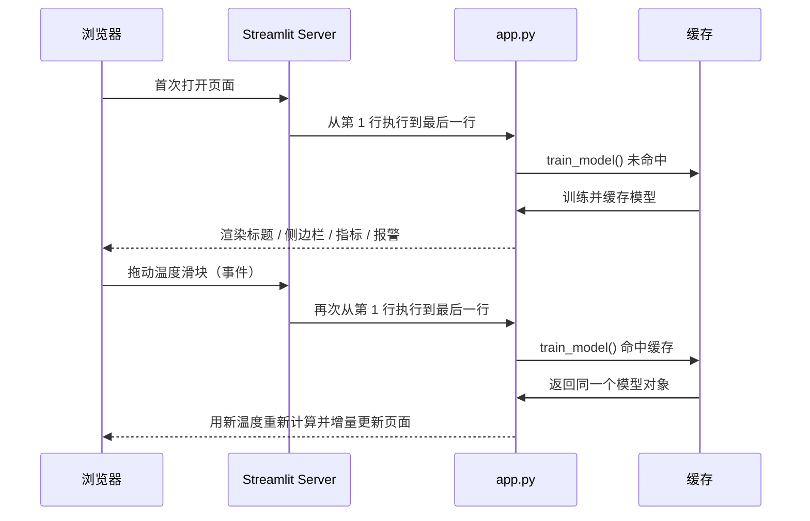
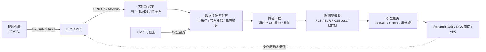

# 【化工数字化】化工软测量交互界面（Streamlit）实战

> **笔记定位**：以 `chemical_code/app.py`（共 51 行）为样本，逐行拆解 Streamlit 的页面配置、资源缓存、侧边栏输入、模型推理、指标展示与报警分支；同时讲清楚“软测量 / 数字孪生”的化工语境、参数含义、数据形状、符号用法、工程坑点、实际应用与不足点。
>
> **验证环境**：Windows + Python 3.11 + Streamlit 1.64.0 + scikit-learn + NumPy。本文所有数值与页面行为均用 `streamlit.testing.v1.AppTest` 在本仓库实测过；根目录 `.venv` 里没有安装 Streamlit，而 `chem_eng` conda 环境已安装 1.64.0，运行时务必确认当前解释器。

**目录**

1. 业务目标与场景
2. 运行环境与启动方式
3. 整体架构与 Streamlit 执行模型
4. 逐行代码精读（L1–L51）
5. 参数手册（重点参数逐个解释）
6. 数据逻辑与形状演算
7. 符号与语法速查
8. 注意事项与避坑清单
9. 化工领域实际应用
10. 不足点与改进方向
11. 改进版代码（最小可运行）
12. 运行与自动化验证
13. 面试话术与自测题

---

## 一、业务目标与场景

### 1.1 什么是软测量

**软测量（Soft Sensor / Inferential Sensor）**：用“容易在线测量的变量”（温度、压力、流量、液位、阀门开度等）作为输入，建立数学模型去**实时估计“难测或测量滞后大”的质量变量**（产品纯度、组成、干点、闪点、分子量、转化率等）。

化工现场的矛盾很典型：

- 在线分析仪（色谱、光谱）贵、维护量大、响应慢；
- 实验室化验（LIMS）可能几小时才出一次结果；
- 但质量控制、先进控制（APC）、报警又需要“秒级/分钟级”的质量数据。

软测量就是用“便宜、快、稳”的过程变量去“推断”质量变量，因此也叫**推断测量**。

### 1.2 本例的业务闭环

本 Demo 模拟一个反应器监控场景：

| 环节 | 本 Demo 的做法 | 化工现场对应 |
|------|----------------|--------------|
| 输入 | 侧边栏拖动“反应器温度 100–150 ℃”“反应器压力 0–1 MPa” | DCS/PLC 实时位号 |
| 模型 | 线性回归 `purity = 0.9 − 0.002·T + 0.1·P` | 软测量模型（PLS/SVR/神经网络等） |
| 输出 | 预测产品纯度，例如 `71.00%` | 在线质量估计值 |
| 决策 | 低于 85% 弹红色报警，否则绿色正常 | 质量报警 / 联锁 / APC 设定值 |

**交互价值**：操作员或工艺工程师拖动滑块，就能做 **what-if（如果……会怎样）** 分析——温度升高 1 ℃，纯度大约掉 0.2 个百分点；压力升高 0.1 MPa，纯度大约涨 1 个百分点。这种“参数敏感性”直观展示，正是 Streamlit 这类工具最擅长的。

### 1.3 先划清边界：这是“软测量看板”，不是完整“数字孪生”

代码标题写的是“数字孪生监控大屏”，但严格来说：

- **软测量**：输入 → 模型 → 质量变量估计，重点是“推断”；
- **数字孪生（Digital Twin）**：物理装置的虚拟镜像，要求**机理模型 + 实时数据同步 + 状态估计/校正 + 双向交互**，可用于仿真、预测、优化和故障推演；
- **本 Demo**：只有一个静态线性回归 + 手工滑块，没有实时数据、没有机理方程、没有状态更新，因此它是**软测量交互原型 / 操作员看板**，不是工业级数字孪生。这个区别在面试和项目汇报里要主动说清楚，避免“名词大于实质”。

---

## 二、运行环境与启动方式

### 2.1 文件位置

```
learning-git/
├─ chemical_code/
│  └─ app.py          ← 本文讲解的 Streamlit 应用（51 行）
└─ notes/
   └─ 化工数字化/
      └─ 化工软测量交互界面(Streamlit)实战.md   ← 本笔记
```

### 2.2 依赖

```bash
pip install streamlit scikit-learn numpy pandas
```

| 库 | 本 Demo 的作用 | 备注 |
|----|----------------|------|
| `streamlit` | Web 界面、控件、缓存、布局 | 本文按 1.64.0 的 API 讲解 |
| `numpy` | 生成模拟数据、组装输入数组 | `np.random`、`np.array` |
| `pandas` | 本 Demo 中**未实际使用** | 只为后续扩展（历史数据表/趋势图）预留 |
| `scikit-learn` | 线性回归模型 | `LinearRegression` |

### 2.3 启动命令

```bash
# 在仓库根目录执行
streamlit run chemical_code/app.py

# 端口被占用时
streamlit run chemical_code/app.py --server.port 8502
```

启动后浏览器打开 `http://localhost:8501`。修改 `app.py` 并保存，页面右上角会出现 **Rerun**；勾选 **Always rerun** 可保存即刷新。

> **环境提示（本机实测）**：如果 `streamlit` 命令找不到，先执行 `python -c "import streamlit; print(streamlit.__version__)"` 看是哪个解释器。仓库根目录的 `.venv` 未安装 Streamlit，而 conda 环境 `chem_eng` 已安装 1.64.0；在 VS Code 里要选对 Python 解释器，否则会出现“明明装了却导入失败”。

### 2.4 开发 vs 生产

- `streamlit run` 适合开发、教学、内网工具；
- 生产部署要考虑反向代理、HTTPS、身份认证（`st.login`/OIDC 或企业 SSO）、审计日志；
- **不要把连接 DCS/PLC 的页面直接暴露到公网**；OT 网络应按 IEC 62443 / 等保思路做分区隔离，数据经 DMZ 单向/受控传输。

---

## 三、整体架构与 Streamlit 执行模型

### 3.1 五层架构

```mermaid
graph TD
    U[操作员 / 工艺工程师<br/>浏览器] -->|拖动滑块| W[Streamlit 前端<br/>WebSocket]
    W -->|触发 rerun| S[app.py 脚本<br/>ScriptRunner]
    S --> C{@st.cache_resource<br/>模型缓存}
    C -->|首次未命中: 训练| M[LinearRegression<br/>coef_ / intercept_]
    C -->|后续命中: 直接复用| M
    S -->|读取 widget 返回值| I[input_data<br/>shape (1, 2)]
    I --> P[model.predict]
    M --> P
    P --> R[st.metric / st.error / st.success]
    R -->|Delta 增量渲染| U

    subgraph 本 Demo 缺失的数据层
        D[DCS / PLC / Historian / LIMS]
    end
    D -.真实项目应接入.-> S
```

| 层 | 代码位置 | 职责 | 关键点 |
|----|----------|------|--------|
| 配置层 | L8 | 页面标题、宽屏布局 | 必须是**第一条** Streamlit 命令 |
| 模型层 | L12–L24 | 生成数据、训练、缓存 | `@st.cache_resource` 只训练一次 |
| 输入层 | L31–L34 | 侧边栏两个滑块 | 返回值直接是 Python `float` |
| 推理层 | L38–L39 | 组装 `(1, 2)` 数组并预测 | 特征顺序必须与训练一致 |
| 展示/报警层 | L42–L51 | 指标卡、红/绿提示 | 阈值 0.85 与“百分数”口径要统一 |

### 3.2 Streamlit 的核心执行模型：每次交互，整个脚本重跑

这是理解 Streamlit 最重要的前提：



由此得到三条结论：

1. **不是“局部回调”思维**：滑块一变，L1–L51 全部重跑；`model = train_model()` 这一行每次都会执行，只是函数体因缓存不再执行。
2. **控件返回值就是“状态”**：`temp = st.sidebar.slider(...)` 每次重跑都会返回当前值，所以不需要手写 `onchange` 去同步。
3. **缓存是性能的生命线**：如果 `train_model()` 里是真实训练（几秒到几小时），没有缓存就会“拖一下卡一下”。本 Demo 训练只有 100×2 的数据，快得几乎感觉不到，但缓存写法是必须养成的工程习惯。

### 3.3 三种“状态”放在哪里

| 状态 | 存放位置 | 生命周期 | 本 Demo |
|------|----------|----------|---------|
| 滑块当前值 | 浏览器 + Streamlit Session State | 每个浏览器会话独立 | `temp`、`press` |
| 训练好的模型 | `@st.cache_resource` 全局缓存 | 进程级，跨会话共享 | `model` |
| 训练数据 / DataFrame | `@st.cache_data`（本例未用） | 进程级，每次返回副本 | 无 |

> **易错点**：`cache_resource` 是**全局共享**的。模型只读没问题；如果你把“当前用户输入”“用户上传的数据”塞进 `cache_resource`，不同用户会互相串数据。用户相关状态应放 `st.session_state`。

### 3.4 数据流（本 Demo 的真实链路）

```
滑块 float
  → np.array([[temp, press]])        # (1, 2)
  → model.predict(...)               # (1,)
  → [0]                              # np.float64 标量
  → f"{prediction:.2%}"              # "71.00%"
  → st.metric(value="71.00%")        # 前端指标卡
  → if prediction < 0.85             # 原始数值比较，不是比较字符串
  → st.error / st.success
```

---

## 四、逐行代码精读（L1–L51）

> 下列行号与 `chemical_code/app.py` 完全对应。空行也会说明其作用，保证“每行都讲到”。

### 4.0 原版全文（对照用）

```python
import streamlit as st
import pandas as pd
import numpy as np
from sklearn.linear_model import LinearRegression

# 1. 页面基本设置（写在最上面）
# 提示：st.set_page_config(page_title="...", layout="wide")
st.set_page_config(page_title="化工数字孪生控制台", layout="wide")

# 2. 缓存模型训练（避免每次拖滑块都重新训练）
# 提示：使用 @st.cache_resource 装饰器
@st.cache_resource
def train_model():
    # 这里用之前的随机数据模拟训练过程
    np.random.seed(42)
    X = np.random.rand(100, 2) * [50, 1] + [100, 0]  # 温度100-150，压力0-1
    # 假设真实规律
    y = 0.9 - 0.002 * X[:, 0] + 0.1 * X[:, 1]
    model = LinearRegression()
    model.fit(X, y)
    return model

# 加载模型
model = train_model()

# 3. 网页布局
st.title("🏭 反应器软测量与数字孪生监控大屏")
st.markdown("---")

# 左侧侧边栏输入
st.sidebar.header("工艺参数输入")
# 提示：使用 st.sidebar.slider() 让用户输入温度和压力
temp = st.sidebar.slider("反应器温度 (℃)", min_value=100.0, max_value=150.0, value=120.0)
press = st.sidebar.slider("反应器压力 (MPa)", min_value=0.0, max_value=1.0, value=0.5)

# 4. 实时预测与显示
# 将输入数据整理成二维数组
input_data = np.array([[temp, press]])
prediction = model.predict(input_data)[0]

# 在网页上显示结果
st.subheader("AI 软测量预测结果")
# 提示：使用 st.metric 显示数字
st.metric(label="预测产品纯度", value=f"{prediction:.2%}")

# 5. 异常报警逻辑
if prediction < 0.85:
    # 提示：使用 st.error 显示红色错误框
    st.error("⚠️ 警告：预测纯度低于工艺设定值（85%），请检查操作参数！")
else:
    st.success("✅ 工况正常，纯度达标。")
```

> 行号包含空行：复制到编辑器后，L1 是 `import streamlit as st`，L51 是最后一行 `st.success(...)`。如果你的编辑器自动删除了行尾空格或重排了空行，行号会有偏差，以代码内容为准。

### 4.1 导入区（L1–L5）

| 行号 | 代码 | 逐行解释 |
|------|------|----------|
| L1 | `import streamlit as st` | 导入 Streamlit，按社区惯例起别名 `st`。之后所有页面元素（标题、滑块、指标、报警框）都通过 `st.xxx` 调用。`import` 只绑定名字，不会立刻画页面；真正画页面的是后面的函数调用。 |
| L2 | `import pandas as pd` | 导入 Pandas，惯例别名 `pd`。**本文件中没有任何地方使用 `pd`**，属于模板式预留：后续要显示历史数据表、`st.dataframe` 或趋势图时才用得上。保留不影响功能，但严格来说会产生“未使用导入”告警，也会让启动多加载一个库。 |
| L3 | `import numpy as np` | 导入 NumPy，别名 `np`。本文件用它做两件事：`np.random.rand` 造模拟数据、`np.array` 把两个滑块值组装成二维输入矩阵。NumPy 是 sklearn 的底层数组依赖。 |
| L4 | `from sklearn.linear_model import LinearRegression` | 从 scikit-learn 的线性模型模块中**只导入 `LinearRegression` 类**。这种写法比 `import sklearn` 更直接，调用时写 `LinearRegression()` 即可。该类实现普通最小二乘（OLS）线性回归。 |
| L5 | 空行 | 用空行把“导入区”和“页面配置区”分开，是 PEP 8 的可读性习惯；空行不执行。 |

**命名习惯**：`st`、`pd`、`np` 是行业通用别名，不要改成 `streamlit123` 之类；`LinearRegression` 用大驼峰（类名），`train_model` 用小写下划线（函数名），符合 Python 规范。

### 4.2 页面配置（L6–L9）

| 行号 | 代码 | 逐行解释 |
|------|------|----------|
| L6 | `# 1. 页面基本设置（写在最上面）` | 注释，说明下面一块的职责。`#` 后面的内容不参与执行，只给人看。 |
| L7 | `# 提示：st.set_page_config(page_title="...", layout="wide")` | 第二行注释，给出 API 形态的“小抄”。注意这只是注释，真正生效的是 L8；注释里的 `...` 不是可运行代码。 |
| L8 | `st.set_page_config(page_title="化工数字孪生控制台", layout="wide")` | 设置页面级配置：`page_title` 决定**浏览器标签页标题**（也用于部分分享场景），`layout="wide"` 让内容使用浏览器全宽（默认 `"centered"` 只有约 730 px 的居中窄栏，做大屏会显得空）。该函数返回 `None`，所以不要写 `config = st.set_page_config(...)`。**硬性规则：它必须是脚本中第一条 Streamlit 命令，且每次运行只能调用一次**；如果先执行 `st.title` 再调用，会抛 `StreamlitAPIException`。1.64 还支持 `page_icon`（favicon/emoji）、`initial_sidebar_state`（`"auto"/"expanded"/"collapsed"`）、`menu_items`（右上角菜单链接）等参数。 |
| L9 | 空行 | 分隔“页面配置区”和“模型训练区”。空行不执行，但让代码块层次清楚；如果被编辑器自动删除，不影响功能，只影响本文的绝对行号。 |

### 4.3 模型训练与缓存（L10–L24）

| 行号 | 代码 | 逐行解释 |
|------|------|----------|
| L10 | `# 2. 缓存模型训练（避免每次拖滑块都重新训练）` | 注释点明“为什么要缓存”。Streamlit 每次交互都会重跑全脚本，如果不缓存，`train_model()` 的函数体每次都会执行。 |
| L11 | `# 提示：使用 @st.cache_resource 装饰器` | 注释提示技术选型：模型属于“不可序列化/昂贵资源”，应使用 `cache_resource`，而不是面向数据的 `cache_data`。 |
| L12 | `@st.cache_resource` | 装饰器：把下面的 `train_model` 包装成“带缓存的函数”。第一次调用真正执行函数体并把返回值存进**全局资源缓存**；以后相同参数调用直接返回**同一个对象**（不拷贝、不重新训练）。缓存键由“函数模块 + 源码 + 参数”共同决定；本函数**没有参数**，所以整个进程只有一份模型，所有浏览器会话共享。默认 `scope="global"`，官方要求被缓存的资源必须**线程安全**（sklearn 模型训练好后只读调用 `predict`，通常没问题）。默认 `show_spinner=True`，首次训练时页面会显示转圈提示。没有设置 `ttl` 时缓存不会过期，直到代码改动、调用 `st.cache_resource.clear()` 或进程重启。 |
| L13 | `def train_model():` | 定义无参函数，返回训练好的模型。无参意味着缓存键稳定；如果要做“模型版本切换”，更推荐显式加参数（如 `version`），让不同版本各自缓存，而不是靠清空全局缓存。 |
| L14 | `# 这里用之前的随机数据模拟训练过程` | 注释说明数据是**合成数据**，不是真实 DCS/化验数据。这一点决定了后面“模型指标很漂亮但不可信”的结论。 |
| L15 | `np.random.seed(42)` | 固定 NumPy **全局随机数种子**，保证每次从头运行时生成同一批数据，便于复现。`42` 是社区常用的“梗值”，本身没有物理意义。注意：`np.random.seed` 影响的是全局 `RandomState`，会“污染”同进程里其他随机逻辑；更现代、线程更安全的写法是 `rng = np.random.default_rng(42)`，再调用 `rng.random(...)`。另外，由于整个函数被缓存，这行只在**首次训练**时执行。 |
| L16 | `X = np.random.rand(100, 2) * [50, 1] + [100, 0]` | 生成 **100 个样本 × 2 个特征** 的输入矩阵，并做仿射变换。拆开看：① `np.random.rand(100, 2)` 生成形状 `(100, 2)` 的 `float64` 数组，每个元素服从 `[0, 1)` 均匀分布；② `* [50, 1]` 利用 NumPy **广播**：列表先变成形状 `(2,)` 的数组，第 0 列乘 50、第 1 列乘 1，于是温度落在 `[0, 50)`、压力仍为 `[0, 1)`；③ `+ [100, 0]` 再给第 0 列加 100、第 1 列加 0，最终温度约 `100–150 ℃`、压力约 `0–1 MPa`。注意 `rand` 的上界是**开区间**，所以严格说温度 `< 150`、压力 `< 1`；注释写“100–150、0–1”是工程上的近似说法。`X[:, 0]` 是温度列，`X[:, 1]` 是压力列。 |
| L17 | `# 假设真实规律` | 注释说明下一行是“人为设定的真实机理”，用来给模型提供学习目标。真实项目中这个 `y` 应来自在线分析仪或实验室化验（并做时间对齐）。 |
| L18 | `y = 0.9 - 0.002 * X[:, 0] + 0.1 * X[:, 1]` | 构造目标变量（产品纯度，**小数口径**，不是百分数）。`X[:, 0]` 中 `:` 表示“所有行”，`0` 表示“第 0 列”，结果是一维数组 `(100,)`；整行按元素运算得到 `(100,)` 的 `y`。系数含义：温度每升高 `1 ℃`，纯度下降 `0.002`（即 **0.2 个百分点**）；压力每升高 `1 MPa`，纯度上升 `0.1`（即 **10 个百分点**）。截距 `0.9` 是数学上的基线，对应 `T=0、P=0`，已远超工艺范围，**不能做物理解释**。该式完全线性、无噪声，所以后面线性回归会得到“完美”结果。 |
| L19 | `model = LinearRegression()` | 实例化一个**未训练**的线性回归估计器。默认 `fit_intercept=True`（会学习截距）、`copy_X=True`、`positive=False`，求解普通最小二乘，没有正则化。此时还没有 `coef_`/`intercept_` 属性。 |
| L20 | `model.fit(X, y)` | 用 100 个样本训练模型：寻找系数 `w` 和截距 `b`，使残差平方和 `Σ(yᵢ − (w·xᵢ + b))²` 最小。`X` 必须是二维 `(n_samples, n_features)`，`y` 是一维 `(n_samples,)`，这里正好满足。`fit` 的返回值是模型自身，但代码没有接收，因为它已经原地“拟合”了 `model`。训练后可得 `model.coef_ ≈ [-0.002, 0.1]`、`model.intercept_ ≈ 0.9`、训练集 `R² = 1.0`。 |
| L21 | `return model` | 返回训练好的模型对象。由于外层 `@st.cache_resource`，这个对象会被存进全局缓存；后续所有会话拿到的是**同一个实例**，不会复制。模型训练后只读，适合共享；但不要在页面里 `model.fit(...)` 再次修改它，否则会污染其他用户。 |
| L22 | 空行 | 函数体结束后的空行，分隔“函数定义”和“模块级调用”。 |
| L23 | `# 加载模型` | 注释，表示下面要“取模型”。严格说不是从磁盘加载，而是“调用带缓存的训练函数”。 |
| L24 | `model = train_model()` | 模块级调用，**每次脚本重跑都会执行这一行**：首次运行时缓存未命中，真正训练；之后拖滑块重跑时缓存命中，直接拿回模型，几乎没有耗时。这也解释了为什么 L12 的缓存是“避免每次拖滑块都重新训练”的关键。若要让新数据生效，需要 `st.cache_resource.clear()`、修改函数源码、改变函数参数（如 `version=2`）或重启进程。 |

> **`cache_resource` vs `cache_data` 一句话区分**：模型、数据库连接、API 客户端 → `cache_resource`（共享同一对象）；DataFrame、查询结果、计算结果 → `cache_data`（每次返回副本，避免被下游修改污染）。两者都要求函数**无副作用**、返回值可预测。

### 4.4 布局与侧边栏输入（L25–L35）

| 行号 | 代码 | 逐行解释 |
|------|------|----------|
| L25 | 空行 | 分隔“模型加载”和“页面布局”。空行不执行，但把模块级调用与后续 UI 代码在视觉上分开。 |
| L26 | `# 3. 网页布局` | 注释，标记“布局区”开始。Streamlit 是**从上到下顺序渲染**的，代码顺序就是页面顺序；侧边栏是例外，它由 `st.sidebar` 显式指定到左侧区域。 |
| L27 | `st.title("🏭 反应器软测量与数字孪生监控大屏")` | 渲染页面主标题（HTML `<h1>` 级别）。字符串里的 🏭 是 Unicode emoji，直接写进源码即可显示；标题支持部分 Markdown（粗体、斜体、行内代码、链接等）。注意它**不是**浏览器标签页标题——标签页标题由 L8 的 `page_title` 控制。 |
| L28 | `st.markdown("---")` | 用 Markdown 渲染一条**水平分割线**（thematic break，对应 HTML `<hr>`）。`st.markdown` 默认 `unsafe_allow_html=False`，不会执行任意 HTML/JS，比较安全；`"---"` 单独一行在 Markdown 中就是分割线，不是 Python 的减号。 |
| L29 | 空行 | 把“主区域布局”和“侧边栏输入”分开。 |
| L30 | `# 左侧侧边栏输入` | 注释，说明下面控件放到左侧。 |
| L31 | `st.sidebar.header("工艺参数输入")` | `st.sidebar` 是一个“侧边栏容器对象”，把紧随其后的元素写进左侧栏；`header` 渲染二级标题风格。等价写法是 `with st.sidebar:` 代码块。侧边栏可由用户折叠，但**折叠不等于不执行**：里面的滑块代码仍然会运行并返回值。 |
| L32 | `# 提示：使用 st.sidebar.slider() 让用户输入温度和压力` | 注释，提示 API。`st.sidebar.slider` 与 `st.slider` 参数完全一致，只是渲染位置不同。 |
| L33 | `temp = st.sidebar.slider("反应器温度 (℃)", min_value=100.0, max_value=150.0, value=120.0)` | 创建温度滑块，并把当前值赋给 `temp`。四个参数：`label` 是显示标签；`min_value`/`max_value` 是允许范围；`value` 是**首次渲染的默认值**，必须落在范围内。因为三个数值参数都是 `float`，Streamlit 判定这是**浮点滑块**，默认步长 `step=0.01`，返回值是 Python `float`（如 `120.0`）。用户拖动滑块会触发**整页 rerun**，`temp` 随之为新值。标签里的 `(℃)` 只是文本，Streamlit 不会做单位换算；模型内部按 ℃ 训练，就必须按 ℃ 输入。 |
| L34 | `press = st.sidebar.slider("反应器压力 (MPa)", min_value=0.0, max_value=1.0, value=0.5)` | 压力滑块，逻辑同上，默认 `0.5 MPa`，步长 `0.01 MPa`。变量名 `press` 是“压力”的简写（名词），不是动词；更规范的命名是 `pressure`，避免与“按压”混淆。两个滑块的 `key` 都没有显式指定，Streamlit 会根据标签和参数自动生成；**如果以后动态改标签/范围/步长，控件身份会变化、值可能被重置**，这时应加稳定的 `key="temp"`。 |
| L35 | 空行 | 分隔输入区和推理区。 |

### 4.5 推理区（L36–L40）

| 行号 | 代码 | 逐行解释 |
|------|------|----------|
| L36 | `# 4. 实时预测与显示` | 注释，“实时”在这里指“交互式即时计算”，不是工业实时（没有时钟、没有数据采集）。 |
| L37 | `# 将输入数据整理成二维数组` | 注释点出关键：sklearn 的 `predict` 要求二维输入，不能直接喂一维的 `[temp, press]`。 |
| L38 | `input_data = np.array([[temp, press]])` | 用**两层方括号**构造二维数组：外层列表是“样本列表”，内层列表是“一个样本的两个特征”，结果形状 `(1, 2)`，即 1 个样本、2 个特征，`dtype=float64`。如果写成 `np.array([temp, press])`，形状是 `(2,)`，`predict` 会报 `Expected 2D array, got 1D array instead`；另一种写法是 `np.array([temp, press]).reshape(1, -1)`。**特征顺序必须是 `[温度, 压力]`**，与 L16 的训练列顺序一致；顺序反了不会报错，但会得到荒谬结果（见 6.4 的实测）。 |
| L39 | `prediction = model.predict(input_data)[0]` | 调用模型的 `predict`：内部计算 `input_data @ coef_ + intercept_`，返回形状 `(1,)` 的 `ndarray`，例如 `[0.71]`；末尾 `[0]` 取出第 1 个元素，得到 `np.float64` 标量 `0.71`。`[0]` 不能省：`f"{np.array([0.71]):.2%}"` 会直接抛 `TypeError: unsupported format string passed to numpy.ndarray.__format__`；`prediction < 0.85` 也会得到形状 `(1,)` 的布尔数组，虽然单元素数组能转成 `bool`，但语义不清、容易埋坑。预测阶段不做训练，只做矩阵乘法，开销极小。 |
| L40 | 空行 | 分隔“算”与“显示”。 |

### 4.6 展示区（L41–L45）

| 行号 | 代码 | 逐行解释 |
|------|------|----------|
| L41 | `# 在网页上显示结果` | 注释。 |
| L42 | `st.subheader("AI 软测量预测结果")` | 渲染二级/三级标题风格的小标题，用于分区。`subheader` 的 `body` 同样支持 Markdown；它只是视觉分组，不影响数据。 |
| L43 | `# 提示：使用 st.metric 显示数字` | 注释，提示用指标卡而不是普通文本。 |
| L44 | `st.metric(label="预测产品纯度", value=f"{prediction:.2%}")` | 渲染一张“大号数字”指标卡。`label` 是卡片标题；`value` 是显示值，这里用 f-string 把 `np.float64(0.71)` 格式化为 `"71.00%"`。格式说明符 `.2%` 的含义：`.` 后接精度 `2` 表示保留 2 位小数，`%` 表示**按百分数显示**（内部乘以 100 并追加 `%`），所以 `0.71 → 71.00%`、`0.8 → 80.00%`。注意 `st.metric` 的 `value` 允许 `int/float/Decimal/str/None`：如果直接传 `prediction`（0.71），页面会显示 `0.71` 而不是 `71.00%`。代码没有用 `delta`，所以没有同比/环比箭头；工业看板通常加 `delta=f"{(prediction - 0.85)*100:+.2f} pp"` 表示“相对设定值的偏差”。1.64 的 `st.metric` 另有 `format`、`border`、`help`、`chart_data` 等参数，但本写法兼容性最好。 |
| L45 | 空行 | 分隔展示区和报警区。 |

### 4.7 报警分支（L46–L51）

| 行号 | 代码 | 逐行解释 |
|------|------|----------|
| L46 | `# 5. 异常报警逻辑` | 注释。工业上“报警”远不止 if/else，后面第 8、10 节会讲报警工程化。 |
| L47 | `if prediction < 0.85:` | 数值比较：`prediction` 是**小数口径**（0–1），`0.85` 代表 85%，两者口径一致；如果写成 `prediction < 85`，条件永远为真，因为任何 0–1 的数都小于 85。这里用严格小于 `<`，所以恰好等于 0.85 时走 `else`（正常）。`np.float64` 与 Python `float` 比较没有问题。阈值是**硬编码魔法数**，真实项目应提成常量或从配置/工艺卡片读取。 |
| L48 | `# 提示：使用 st.error 显示红色错误框` | 注释。 |
| L49 | `st.error("⚠️ 警告：预测纯度低于工艺设定值（85%），请检查操作参数！")` | 渲染红色错误框，`body` 支持 Markdown 和 emoji。它是**页面内静态提示**，不是弹窗、不是声音、不会写日志、不会通知 DCS；用户刷新/重跑后按新状态重新渲染。文本中的 ⚠️ 是 emoji（带变体选择符），源文件需以 UTF-8 保存，否则 Windows 控制台/编辑器里可能出现乱码。 |
| L50 | `else:` | 与 L47 配对的分支。由于本例模型的理论上限是 0.8（见 6.3 实测），这个 `else` **实际上永远不会执行**——这是一个隐藏的逻辑缺陷。 |
| L51 | `st.success("✅ 工况正常，纯度达标。")` | 渲染绿色成功框，表示工况正常。✅ 同样是 emoji。真实项目中“正常”不应只靠绿色文字，还应结合趋势、置信度、报警抑制和操作确认。 |

> **读代码时要问的三个问题**：① 这个分支真的能被触发吗？② 这个阈值和模型输出的量纲一致吗？③ 如果我拖动滑块到边界，结果还合理吗？本例第 ② 问就暴露了“永远报警”的问题。

---

## 五、参数手册（重点参数逐个解释）

### 5.1 `st.set_page_config`

```python
st.set_page_config(
    page_title="化工数字孪生控制台",
    page_icon="🏭",
    layout="wide",
    initial_sidebar_state="expanded",
)
```

| 参数 | 类型 / 默认 | 作用 | 注意事项 |
|------|-------------|------|----------|
| `page_title` | `str \| None`，默认 `None` | 浏览器标签页标题 | 不设置时 Streamlit 用默认标题；与 `st.title` 无关 |
| `page_icon` | `str \| None` | favicon，可用 emoji 或图片路径 | 支持 `":material/factory:"` 这类 Material Symbols |
| `layout` | `"centered"`（默认）/`"wide"` | 内容宽度 | 大屏、表格、双栏图用 `"wide"` |
| `initial_sidebar_state` | `"auto"`（默认）/`"expanded"`/`"collapsed"` | 侧边栏初始状态 | 移动端会自动适配；折叠仍会执行侧边栏代码 |
| `menu_items` | `dict \| None` | 右上角菜单里的链接 | 如 `{"Get help": "https://..."}` |

**三条硬规则**：① 必须是第一条 Streamlit 命令；② 每次脚本运行只能调用一次；③ 不要把它放进条件分支或函数里“按需调用”，否则很容易违反前两条。

### 5.2 `@st.cache_resource`

```python
@st.cache_resource(ttl=None, max_entries=None, show_spinner=True, scope="global")
def train_model(version: int = 1):
    ...
```

| 参数 | 类型 / 默认 | 作用 | 注意事项 |
|------|-------------|------|----------|
| `ttl` | `float \| timedelta \| str \| None` | 缓存存活时间，如 `"10m"`、`3600` | 不设则不过期；模型热更新可配合 `ttl` |
| `max_entries` | `int \| None` | 最多缓存多少个不同参数组合 | 参数化训练时防止内存无限增长 |
| `show_spinner` | `bool \| str`，默认 `True` | 首次计算时是否显示转圈 | 可传字符串自定义提示 |
| `show_time` | `bool`，默认 `False` | 是否在转圈提示里显示耗时 | 调性能时临时打开 |
| `validate` | `callable \| None` | 缓存命中后校验返回值；抛异常则重算 | 返回值可能“过期但可哈希”时用 |
| `scope` | `"global"`（默认）/`"session"` | 全局共享还是每会话一份 | 全局资源必须线程安全；用户相关资源用 `"session"` |
| `hash_funcs` | `dict \| None` | 自定义参数哈希函数 | 参数是自定义对象/连接时用 |
| `on_release` | `callable \| None` | 缓存释放时回调 | 用于关闭连接、释放显存 |
| `refresh_mode` | `"foreground"`（默认）/`"background"` | 过期后前台阻塞重算或后台刷新 | 后台刷新需要 `ttl` |

**缓存失效条件**：函数源码变化、调用参数变化、`st.cache_resource.clear()`、进程重启、`ttl` 到期。**不要缓存有副作用的函数**（如写文件、发请求、改全局变量），否则“第二次不执行”会让你误以为代码坏了。

### 5.3 `st.slider` / `st.sidebar.slider`

```python
temp = st.sidebar.slider(
    "反应器温度 (℃)",
    min_value=100.0,
    max_value=150.0,
    value=120.0,
    step=0.5,
    format="%.1f ℃",
    key="reactor_temp",
    help="温度越高，副反应越明显，纯度下降。",
)
```

| 参数 | 类型 / 默认 | 作用 | 注意事项 |
|------|-------------|------|----------|
| `label` | `str` | 控件标签 | 不要为空；需要隐藏时用 `label_visibility="collapsed"` |
| `min_value` | 数值 / `None` | 最小值 | 不传时：`int→0`、`float→0.0` |
| `max_value` | 数值 / `None` | 最大值 | 不传时：`int→100`、`float→1.0` |
| `value` | 数值 / 二元组 / `None` | 初始值；传 `(low, high)` 变成**范围滑块** | 必须落在 `[min_value, max_value]` 内，且类型与两端一致（int/float 不可混用） |
| `step` | `int/float/timedelta/None` | 步长 | 默认：`int→1`、`float→0.01`；改步长会重置控件 |
| `format` | `str/None` | **显示格式**，如 `"%.1f ℃"`、`"%.2f"` | 只影响显示，不影响返回值 |
| `key` | `str/int/None` | 稳定控件身份，可用 `st.session_state[key]` 读写 | 动态标签/范围时强烈建议加 |
| `help` | `str/None` | 标签旁的悬浮提示 | 仅在标签可见时显示 |
| `disabled` | `bool`，默认 `False` | 禁用控件 | 权限控制/流程锁定 |
| `label_visibility` | `"visible"/"hidden"/"collapsed"` | 标签可见性 | 无障碍要求：不要用空标签替代 |

**返回值类型**：由 `min_value`、`max_value`、`value` 的类型决定；三者都是 `float` 就返回 `float`，都是 `int` 就返回 `int`。**三者类型必须一致**：在 1.64 中，`min_value=100`、`max_value=150`、`value=120.5` 会直接抛 `StreamlitInvalidParameterTypeError: Invalid value type...`，不会自动做类型提升。因此要**显式统一**（本例全部写 `100.0/150.0/120.0`），避免“有时 120、有时 120.0”导致格式化/哈希差异。

### 5.4 `st.metric`

| 参数 | 类型 / 默认 | 作用 | 注意事项 |
|------|-------------|------|----------|
| `label` | `str` | 指标名称 | 支持部分 Markdown |
| `value` | `int/float/Decimal/str/None` | 主数值 | 传字符串就按原样显示；`None` 显示长横线 |
| `delta` | 数值/字符串/`None` | 变化量，带箭头和颜色 | 正数绿色向上、负数红色向下、0 灰色 |
| `delta_color` | `"normal"/"inverse"/"off"/颜色名` | 变化颜色语义 | 成本、能耗等“越低越好”用 `"inverse"` |
| `help` | `str/None` | 悬浮说明 | 适合写“模型版本/更新时间” |
| `border` | `bool`，默认 `False` | 是否显示卡片边框 | 大屏 KPI 行常用 |
| `format` | `str/None` | 数字格式（1.64 支持） | 如 `"%.2f"`、`"localized"`；传字符串值时可能被忽略 |
| `chart_data` | 序列/`None` | 指标卡内迷你趋势图 | 需要历史序列，本例没有 |

### 5.5 文本与反馈 API

| API | 渲染效果 | 常用参数 | 说明 |
|-----|----------|----------|------|
| `st.title` | 页面主标题 | `body`、`anchor`、`help`、`icon` | 每个页面通常只用一个 |
| `st.subheader` | 分区小标题 | `body`、`divider`、`anchor` | 适合“预测结果”“模型信息” |
| `st.sidebar.header` | 侧边栏标题 | 同 `header` | 等价于 `with st.sidebar: st.header(...)` |
| `st.markdown` | Markdown 文本 | `body`、`unsafe_allow_html=False` | `"---"` 画分割线；默认不执行 HTML |
| `st.error` | 红色错误框 | `body`、`icon`、`title` | 适合硬报警/校验失败 |
| `st.success` | 绿色成功框 | `body`、`icon`、`title` | 适合“达标/保存成功” |
| `st.warning` / `st.info` | 黄/蓝提示框 | 同上 | 警告/一般信息，工业看板常用黄色预警 |

### 5.6 参数使用的四条原则

1. **关键字参数优先**：`st.slider(label="温度", min_value=100.0, ...)` 比按位置传参更可读，也避免 API 升级后位置变化。
2. **类型一致**：滑块范围、默认值、模型输入、阈值都用同一量纲/类型；不要一会儿小数、一会儿百分数。
3. **范围包含默认值**：`value` 必须在 `[min_value, max_value]` 内，否则启动即报错。
4. **显示与计算分离**：`format`、`f"{x:.2%}"` 只负责“好看”，`if` 判断必须用原始数值；不要拿格式化后的字符串去比较。

---

## 六、数据逻辑与形状演算

### 6.1 中间变量一览

| 变量 | 产生位置 | 类型 / 形状 | 含义 |
|------|----------|-------------|------|
| `X` | L16 | `ndarray (100, 2)`，`float64` | 100 个训练样本；第 0 列温度（℃），第 1 列压力（MPa） |
| `y` | L18 | `ndarray (100,)`，`float64` | 每个样本对应的产品纯度（小数，0–1） |
| `model` | L19–L21 | `LinearRegression` 实例 | 已拟合的 OLS 模型，含 `coef_`、`intercept_` |
| `temp` | L33 | `float` | 当前滑块温度，默认 `120.0` |
| `press` | L34 | `float` | 当前滑块压力，默认 `0.5` |
| `input_data` | L38 | `ndarray (1, 2)`，`float64` | 1 个待预测样本 |
| `prediction` | L39 | `np.float64` 标量 | 预测纯度，默认 `0.71` |

### 6.2 广播（broadcasting）到底做了什么

L16 是初学者最容易“看懂字面、看不懂形状”的一行。把它拆成三步：

| 步骤 | 表达式 | 形状变化 | 数值效果 |
|------|--------|----------|----------|
| ① 随机矩阵 | `np.random.rand(100, 2)` | `(100, 2)` | 每个元素 ∈ `[0, 1)` |
| ② 按列缩放 | `* [50, 1]` | `(100, 2) * (2,) → (100, 2)` | 第 0 列 ×50，第 1 列 ×1 |
| ③ 按列平移 | `+ [100, 0]` | `(100, 2) + (2,) → (100, 2)` | 第 0 列 +100，第 1 列 +0 |
| 结果 | `X` | `(100, 2)` | 温度 ≈ `[100, 150)`，压力 ≈ `[0, 1)` |

用两个元素举例：

```text
[0.42, 0.73]  ×  [50, 1]  =  [21.0, 0.73]
[21.0, 0.73]  +  [100, 0] =  [121.0, 0.73]
                            ↑ 温度 121 ℃，压力 0.73 MPa
```

NumPy 的规则是**从尾部维度对齐**：`(100, 2)` 与 `(2,)` 可以广播，因为最后一维都是 2；`(100, 2)` 与 `(100,)` 则不能直接按列广播（会尝试对齐到行，通常报错或得到意外结果）。把列表写成 `[[50, 1]]`（形状 `(1, 2)`）也能得到同样结果，但 `[50, 1]` 更简洁。

### 6.3 手算默认工况与边界工况

默认工况 `T = 120.0 ℃`、`P = 0.5 MPa`：

```text
purity = 0.9 − 0.002 × 120 + 0.1 × 0.5
       = 0.9 − 0.24 + 0.05
       = 0.71
```

`f"{0.71:.2%}"` → `"71.00%"`，与页面实测一致。

把滑块推到四个角，结果如下（均为实测/公式计算）：

| 温度 T (℃) | 压力 P (MPa) | 预测纯度 | 显示 | `prediction < 0.85` | 页面分支 |
|------------|--------------|----------|------|---------------------|----------|
| 120 | 0.5 | 0.710 | 71.00% | True | 红色报警 |
| 100 | 0 | 0.700 | 70.00% | True | 红色报警 |
| 100 | 1 | **0.800** | **80.00%** | True | 红色报警 |
| 150 | 0 | 0.600 | 60.00% | True | 红色报警 |
| 150 | 1 | 0.700 | 70.00% | True | 红色报警 |

**结论：在滑块允许的整个范围内，预测值的理论上限只有 0.8（80%），永远达不到 0.85。** 因此 `else` 分支（L50–L51）是**死代码**，绿色 `st.success` 永远不会出现。用随机种子 42 实际生成的数据，`y` 的样本范围是 `0.6201–0.7949`，训练集里也没有一个“达标”样本。这不是 Streamlit 的问题，而是**模型规律、输入范围、报警阈值三者没有对齐**的典型数据逻辑缺陷。

### 6.4 特征顺序：最危险的“静默错误”

训练时列顺序是 `[温度, 压力]`。如果推理时手滑写成 `[[press, temp]]`，sklearn **不会报错**（因为形状仍是 `(1, 2)`、特征数仍是 2），但模型会把 0.5 当温度、120 当压力：

```text
错误预测 = 0.9 − 0.002 × 0.5 + 0.1 × 120
         = 0.9 − 0.001 + 12
         = 12.899
```

页面会显示 `1289.90%`，而且 `12.899 < 0.85` 为 `False`，于是给出**绿色“工况正常”**。一个量纲完全错误的输入，得到了一个“看起来很开心”的结论——这是软测量工程里最需要防的一类 bug。

**防御措施**：

- 训练和推理共用同一个特征列表常量，例如 `FEATURES = ["temperature", "pressure"]`；
- 用 `sklearn.pipeline.Pipeline` 封装预处理 + 模型，并保存特征名；
- 推理前校验 `input_data.shape == (1, len(FEATURES))`；
- 对输出做物理范围校验（纯度应在 `[0, 1]`），超出就报警而不是显示；
- 单元测试覆盖“交换特征顺序应产生异常或明显越界”。

### 6.5 数值类型与精度链

```text
temp / press        Python float
        ↓ np.array
input_data          ndarray shape (1, 2), dtype float64
        ↓ model.predict
predict 返回        ndarray shape (1,), dtype float64
        ↓ [0]
prediction          np.float64 标量（默认工况内部是 0.70999999999999996）
        ↓ f"{prediction:.2%}"
显示字符串          "71.00%"
        ↓ st.metric
前端指标卡          视觉文本
```

几个容易忽略的点：

- 浮点数不能直接用 `==` 判断相等；本例默认工况的内部值是 `0.70999999999999996`，不是精确的 `0.71`。如果必须比较，用 `math.isclose` 或 `np.isclose`。
- `:.2%` 会**四舍五入到 2 位小数**；显示 `85.00%` 不代表内部值恰好是 `0.85`，可能只是 `0.849999` 被显示成了 `85.00%`。阈值判断必须用原始数值，不能拿显示字符串比较。
- 温度、压力、纯度都没有做单位换算；模型系数 `−0.002` 的单位是“每 ℃ 的纯度小数变化”，`0.1` 的单位是“每 MPa 的纯度小数变化”。换单位（K、bar）必须重新训练或换算输入，不能直接套用。

### 6.6 报警逻辑真值表

| 条件 | 结果 | 本 Demo 是否可达 |
|------|------|------------------|
| `prediction < 0.85` | `st.error` 红色报警 | ✅ 所有输入都可达 |
| `prediction == 0.85` | `st.success` 绿色正常 | ❌ 模型无法产生恰好 0.85 |
| `prediction > 0.85` | `st.success` 绿色正常 | ❌ 理论最大值 0.8 |

**如果想让两个分支都合理**，有三种思路：① 把阈值改成与模型量程匹配的值（例如 0.75）；② 重新设计模型/数据，让纯度覆盖 0.6–0.98；③ 保留 0.85 阈值，但把输入范围扩大到能产生达标的工况（并重新训练）。**不能**只改显示文字，否则数据逻辑仍然是错的。

---

## 七、符号与语法速查

### 7.1 Python 基础符号

| 符号 / 写法 | 名称 | 在本代码中的例子 | 作用与注意 |
|-------------|------|------------------|------------|
| `#` | 注释 | `# 1. 页面基本设置` | 其后内容不执行；不要用它“注释掉”大段代码，容易失控 |
| `import ... as ...` | 导入并起别名 | `import streamlit as st` | 别名是约定，不是强制；`as` 后可接任意合法标识符 |
| `from ... import ...` | 从模块导入指定对象 | `from sklearn.linear_model import LinearRegression` | 只导入一个类，避免 `sklearn.linear_model.LinearRegression` 长链 |
| `@` | 装饰器 | `@st.cache_resource` | 把下一行的函数传给装饰器加工；**不是**矩阵乘法（NumPy 矩阵乘法也用 `@`，语境不同） |
| `def` | 定义函数 | `def train_model():` | 函数体必须缩进 4 个空格 |
| `return` | 返回 | `return model` | 结束函数并把对象交给调用者；没有 `return` 时返回 `None` |
| `()` | 调用/参数列表 | `LinearRegression()` | 类名后加 `()` 才是实例化；`def` 行的小括号是参数列表 |
| `=` | 赋值 / 关键字参数 | `temp = ...`、`min_value=100.0` | 赋值是“把右边给左边”；函数调用里的 `=` 是“参数名=值” |
| `==` | 相等比较 | 本代码未用 | 与 `=` 完全不同；浮点数比较要小心精度 |
| `<` | 小于 | `if prediction < 0.85:` | 返回 `bool`；严格小于，等于时不成立 |
| `if / else` | 条件分支 | L47–L51 | 冒号不能漏；分支体缩进 4 个空格 |
| `.` | 属性/方法访问 | `st.sidebar.slider`、`model.predict` | 从左到右逐层取属性；`st.sidebar` 是容器对象 |
| `,` | 分隔参数/元素 | `np.array([[temp, press]])` | 末尾逗号在 Python 中合法，但风格上保持一致 |
| `[]` | 列表 / 索引 | `[50, 1]`、`X[:, 0]` | 列表是可变序列；索引从 0 开始 |
| `:` | 切片 / 字典 / 缩进标记 | `X[:, 0]`、`{"a": 1}`、`if ...:` | 在 `[]` 内是切片；在语句末尾是块开始 |
| `...` | 省略号 | 本代码没有 | 在类型提示/占位符中表示“省略”；不是可运行代码 |
| `None` | 空值 | 参数默认值常见 | 不是 `0`、不是空字符串；`st.metric(value=None)` 会显示长横线 |

### 7.2 NumPy 与数据形状符号

| 写法 | 形状 / 结果 | 解释 |
|------|-------------|------|
| `np.random.rand(100, 2)` | `(100, 2)` | 100 行 2 列，元素 ∈ `[0, 1)`；参数是**维度**，不是范围 |
| `X * [50, 1]` | `(100, 2)` | 广播：第 0 列 ×50，第 1 列 ×1；列表自动转成 `(2,)` 数组 |
| `X + [100, 0]` | `(100, 2)` | 广播：第 0 列 +100，第 1 列 +0 |
| `X[:, 0]` | `(100,)` | `:` 取所有行，`0` 取第 0 列；结果降维成一维 |
| `X[:, 0:1]` | `(100, 1)` | 切片保留二维；需要“列向量”时用这种写法 |
| `X[:, 1]` | `(100,)` | 第 1 列（压力） |
| `np.array([[temp, press]])` | `(1, 2)` | 外层列表 = 样本维，内层列表 = 特征维；**双层方括号**是关键 |
| `np.array([temp, press])` | `(2,)` | 一维，`predict` 会报错；需要 `reshape(1, -1)` |
| `model.predict(...)` | `(1,)` | 每个样本一个预测值；单样本也返回数组而不是标量 |
| `...[0]` | 标量 | 取数组第一个元素；链式索引，先算 `predict` 再取 `[0]` |
| `model.coef_` | `(2,)` | 训练后才有；顺序与 `X` 的列顺序一致 |
| `model.intercept_` | 标量 | 截距；`fit_intercept=True` 时学习得到 |

### 7.3 字符串与格式化符号

| 写法 | 结果 | 解释 |
|------|------|------|
| `f"{prediction:.2%}"` | `"71.00%"` | `f` 前缀启用 f-string；`{}` 内是表达式；`:` 后是格式说明符 |
| `.2` | 精度 2 位小数 | 对浮点数而言是小数点后 2 位 |
| `%`（格式说明符） | 百分比 | 乘以 100、追加 `%`；**不是** Python 的取模运算符（语境不同） |
| `f"{x:+.2f}"` | `"+1.20"` | `+` 强制显示正负号；工业偏差常用“+0.30 pp” |
| `"%.1f ℃"` | `"120.0 ℃"` | 旧式 printf 风格；可用于 `st.slider(format=...)` |
| `"---"` | 水平线 | Markdown 语法，不是 Python 运算符 |
| `"wide"` / `"centered"` | 布局字符串 | 必须用合法字面量；写错会报错或退回默认 |
| `"⚠️"` / `"✅"` / `"🏭"` | emoji | Unicode 字符；文件必须 UTF-8；终端/字体不支持时会显示方块 |
| `"℃"` / `"MPa"` | 单位符号 | `℃` 是 U+2103 单字符；也可写 `°C`（两个字符），两者不等价 |
| `"（85%）"` | 全角括号/百分号 | 中文排版可用；不要与代码中的半角 `()`/`%` 混淆 |

### 7.4 Streamlit / 对象符号

| 写法 | 含义 | 注意 |
|------|------|------|
| `st.` | Streamlit 顶层命名空间 | 所有 API 从这里取 |
| `st.sidebar.` | 侧边栏容器 | 不是函数，是对象；也可 `with st.sidebar:` |
| `st.set_page_config(...)` | 页面配置 | 第一条命令、只一次 |
| `@st.cache_resource` | 资源缓存装饰器 | 放在 `def` 正上方；可带参数 `@st.cache_resource(ttl="1h")` |
| `st.cache_resource.clear()` | 清空资源缓存 | 重新训练/换模型时用；会清掉所有该装饰器的缓存 |
| `st.metric(label=..., value=...)` | 指标卡 | `label`/`value` 是关键字参数，顺序可换 |
| `st.error(...)` / `st.success(...)` | 反馈框 | 参数名是 `body`，不是 `text`；支持 Markdown |
| `st.title(...)` / `st.subheader(...)` | 标题 | 只影响展示，不影响逻辑 |

### 7.5 最容易混淆的四组符号

1. **`=` vs `==`**：赋值 vs 比较。`if prediction = 0.85` 是语法错误。
2. **`@` 装饰器 vs `@` 矩阵乘法**：`@st.cache_resource` 是装饰器；`A @ B` 是矩阵乘法。看语境。
3. **`%` 格式化 vs `%` 取模**：`f"{x:.2%}"` 里是格式符；`7 % 3` 是取模。
4. **`:` 切片 vs `:` 语句块**：`X[:, 0]` 里是切片；`if x < 0.85:` 末尾是块开始。

---

## 八、注意事项与避坑清单

### 8.1 Streamlit 层面

| # | 坑点 | 典型现象 | 正确做法 |
|---|------|----------|----------|
| 1 | `set_page_config` 位置不对 | `StreamlitAPIException: set_page_config() can only be called once per app...` | 放在所有 `st.` 调用之前；只调用一次；不要放进函数/条件分支 |
| 2 | 以为只有回调局部刷新 | 拖滑块后模型重新训练、页面卡顿 | 记住“整脚本重跑”；把训练/加载/查询放进 `@st.cache_resource` 或 `@st.cache_data` |
| 3 | 用 `cache_data` 缓存模型 | 每次返回副本、模型对象可能无法序列化或丢失状态 | 模型/连接/客户端用 `cache_resource`；DataFrame/查询结果用 `cache_data` |
| 4 | 缓存永不失效 | 换了训练数据，页面还是旧预测 | 用 `ttl`、`max_entries`、版本参数（`version=2`）或 `st.cache_resource.clear()`；进程重启也会清空 |
| 5 | 在缓存函数里做副作用 | 第二次调用没有写文件/没有发请求，误以为代码坏了 | 缓存函数保持纯函数；副作用放缓存外，或接受“只执行一次”的语义 |
| 6 | 把用户数据放全局缓存 | A 用户看到 B 用户的数据 | 用户相关状态放 `st.session_state`；资源缓存用 `scope="session"` 或只读全局资源 |
| 7 | 动态改滑块标签/范围/步长 | 控件值被重置、`session_state` 对不上 | 给控件稳定 `key`；范围/步长变化本身会重置控件，需在业务上接受 |
| 8 | 以为侧边栏折叠就不执行 | 折叠后逻辑仍然运行、仍然触发重算 | 侧边栏只是视觉容器；需要“禁用”用 `disabled=True` 或条件分支 |
| 9 | 把 `st.metric` 当计算值 | 用显示字符串 `"71.00%"` 去比较，得到字符串比较结果 | 保留原始数值 `prediction` 做判断；字符串只用于展示 |
| 10 | 把 `st.error` 当工业报警 | 刷新即消失、无声音、无确认、无记录 | 工业报警需报警管理（ISA-18.2）、历史库、确认/抑制/延时；页面只是展示层 |
| 11 | 每个控件都触发全页重跑 | 多个输入时频繁重算 | 用 `st.form` 批量提交，或 `@st.fragment` 隔离局部刷新；重活加缓存 |
| 12 | 忘记处理异常 | 训练失败时整页 traceback，操作员看不懂 | `try/except` 包裹数据加载/训练，失败时 `st.error` + 日志；区分“无数据”和“模型错误” |

### 8.2 数据与模型层面

| # | 坑点 | 典型现象 | 正确做法 |
|---|------|----------|----------|
| 13 | 特征顺序写反 | 页面显示 `1289.90%`，还绿色“正常” | 固定 `FEATURES` 常量；Pipeline 保存特征名；推理前校验形状与顺序 |
| 14 | 输入是一维 | `Expected 2D array, got 1D array instead` | `np.array([[temp, press]])` 或 `.reshape(1, -1)` |
| 15 | 单位不统一 | 温度用 K、模型按 ℃ 训练，预测完全跑偏 | 统一单位并在标签/文档写清楚；换算放在入口处，只做一次 |
| 16 | 阈值口径不一致 | `prediction < 85` 永远为真；或 `0.85` 与 `85%` 混用 | 统一用小数（0–1）或统一用百分数（0–100）；常量命名 `PURITY_SETPOINT = 0.85` |
| 17 | 分支不可达 | `else` 永远不执行，测试覆盖率造假 | 用边界值/等价类测试；本例理论上限 0.8，必须改阈值或改模型 |
| 18 | 输出越界 | 预测出 `-0.3` 或 `1.8` 的“纯度” | 物理范围校验/裁剪；越界时报警而不是继续显示；使用带约束的模型 |
| 19 | 浮点数直接比较 | `0.1 + 0.2 != 0.3` 类问题 | 用 `math.isclose`/`np.isclose`；比较前明确容差 |
| 20 | 用训练集 R² 当泛化指标 | 本例 `R²=1.0`，误以为模型完美 | 划分训练/测试（时间序列按时间切），看 RMSE/MAE/R²、残差、外推表现 |
| 21 | 合成数据当真实数据 | 规律太干净，现场一上就崩 | 用 DCS/化验数据；加入噪声、滞后、工况变化、异常值；做数据对齐 |
| 22 | 外推使用 | 滑块范围超出训练域，模型仍在“自信”预测 | 限制输入到训练域；超出时 `st.warning`；树模型尤其不能外推 |
| 23 | 多变量共线性 | 温度与压力高度相关，系数符号反直觉 | 看 VIF/相关性；用 PCA/PLS/Ridge；不要只解释单个系数 |
| 24 | 随机种子污染 | 同进程其他随机逻辑被 `np.random.seed` 影响 | 用 `np.random.default_rng(42)` 局部生成器；把种子作为参数记录 |
| 25 | 模型版本/持久化缺失 | 每次冷启动重训；换版本无法追溯 | `joblib.dump/load`、MLflow/模型注册表；缓存键带版本号；记录训练数据时间戳 |

### 8.3 工程与安全层面

| # | 坑点 | 正确做法 |
|---|------|----------|
| 26 | 把 DCS/PLC 连接信息写进代码 | 用 `st.secrets`/环境变量；`.streamlit/secrets.toml` 加入 `.gitignore` |
| 27 | 页面直接暴露到公网 | 反向代理 + HTTPS + SSO/`st.login`；OT/IT 分区，DMZ 受控转发，最小权限只读 |
| 28 | 没有日志与审计 | 记录谁在何时改了哪个设定值、模型版本、预测值；日志脱敏后集中存储 |
| 29 | 依赖版本漂移 | `requirements.txt`/`pyproject.toml` 锁版本；CI 里跑 `python -m compileall` 和 AppTest |
| 30 | 中文/emoji 乱码 | 源文件 UTF-8；Windows 终端设 `PYTHONIOENCODING=utf-8`；避免在关键报警文本里只用 emoji 表达含义 |
| 31 | 未使用导入/死代码 | 删除 `pandas`（若不用）或真正用起来；CI 加 `ruff`/`flake8`；死分支加注释或删除 |
| 32 | 把教学 Demo 当生产系统 | 明确“原型/演示”边界；上线前补数据接入、模型监控、报警管理、权限、备份、回滚 |

### 8.4 上线前自检清单

- [ ] `streamlit run` 能启动，无 traceback；
- [ ] 默认值、边界值、非法值都试过；
- [ ] 每个 `if/else` 分支都能被触发（或有明确“不可达”说明）；
- [ ] 模型输入形状/顺序/单位与训练一致；
- [ ] 预测值有物理范围校验；
- [ ] 缓存失效策略明确（数据更新后多久生效）；
- [ ] 页面文案写清楚“模型版本、训练时间、适用范围、置信度”；
- [ ] 报警有日志、有确认、有抑制，不是只有一个红框；
- [ ] 权限/密钥/网络边界符合企业安全规范；
- [ ] 有自动化测试（至少 AppTest 冒烟 + 关键边界用例）。

---

## 九、化工领域实际应用

### 9.1 典型装置与软测量目标

| 装置 / 场景 | 难测目标变量 | 常用易测输入 | 主要难点 | 常用模型 |
|-------------|--------------|--------------|----------|----------|
| 常减压蒸馏 | 柴油 95% 馏出温度、闪点、倾点 | 塔顶/侧线温度、回流比、进料性质、蒸汽量 | 多侧线耦合、进料变化、分析滞后 | PLS、PCR、ANN |
| 催化裂化（FCC） | 汽油辛烷值、转化率、轻油收率 | 反应温度、剂油比、再生温度、原料残炭 | 强非线性、催化剂老化、工况切换 | SVR、随机森林、XGBoost |
| 乙烯裂解炉 | 裂解深度、乙烯/丙烯收率 | 炉管出口温度 COT、停留时间、稀释蒸汽比、原料组成 | 高温结焦、在线分析少、动态强 | 机理 + 数据混合、LSTM |
| 聚合反应器 | 熔融指数 MI、分子量分布、转化率 | 温度、压力、单体/催化剂流量、氢气浓度 | 强放热、滞后大、牌号切换 | PLS、动态神经网络 |
| 精馏塔 | 塔顶/塔底组成、回收率 | 灵敏板温度、压力、回流比、再沸器负荷 | 非线性、共线、仪表漂移 | 机理模型 + 数据校正、PLS |
| 制药结晶 | 晶型、粒度分布、纯度 | 温度、过饱和度、搅拌转速、pH、溶剂比例 | 批次差异、PAT 光谱复杂 | PCA/PLS、SVM、深度学习 |
| 污水处理 | COD、氨氮、总氮 | pH、ORP、DO、进水流量、曝气量、温度 | 大滞后、时变、天气扰动 | LSTM/GRU、随机森林 |
| 反应器（通用） | 转化率、选择性、副产物 | 温度、压力、停留时间、进料配比 | 机理复杂、工况多 | 机理 + 数据、GPR |

### 9.2 工业数据链路（本 Demo 缺的那一段）



本 Demo 只实现了 **E→F→H 的一小段**（而且是手工输入），A–D 和 L 全部缺失。真正上装置时，**数据接入与对齐的工作量往往占 70% 以上**，建模只占一小部分。

### 9.3 软测量项目落地流程

1. **定义目标**：质量变量是什么？化验方法、采样频率、允许误差、滞后时间各是多少？
2. **选变量**：从机理出发（物料/能量平衡）筛出相关变量，再用相关性、PCA、VIF 去掉冗余；不要“把能拿到的位号全塞进去”。
3. **数据对齐**：统一时间戳、重采样、补偿死时间（dead time）；化验值通常滞后数小时，必须按“采样时刻 + 分析延迟”对齐。
4. **数据清洗**：剔除开停车、手动、仪表故障、冻结值、异常工况；做稳态检测（如滑动窗口方差阈值）。
5. **特征工程**：滑动平均/中值滤波、差分、累计量、比值（如剂油比、回流比）、滞后特征。
6. **建模**：优先线性/PLS 做基线，再试 SVR、树模型、LSTM；样本少时不要一上来就深度学习。
7. **验证**：按时间划分训练/测试（不能随机打乱时序），看 RMSE/MAE/R²、残差随时间的漂移、不同工况下的表现；给出置信区间或适用域。
8. **部署与监控**：模型服务化、输入校验、输出限幅、漂移监控、定期用新化验值更新；报警接入报警管理系统。

### 9.4 工程化必须回答的六个问题

| 问题 | 为什么重要 | 本 Demo 的状态 |
|------|------------|----------------|
| 化验值滞后多久？ | 标签与特征错位会让模型学错 | 无真实标签，不涉及 |
| 采样频率一致吗？ | DCS 秒级、化验小时级，需重采样 | 无时间维度 |
| 工况是否稳态？ | 开停车/切换牌号时模型不适用 | 无工况概念 |
| 模型适用域在哪？ | 外推预测可能荒谬 | 滑块限制在训练域内（唯一做得好的点） |
| 模型漂移了吗？ | 催化剂老化/结垢/换季会改变关系 | 无监控 |
| 预测不准时怎么办？ | 必须有 fallback（化验值/上一次模型/人工） | 无 fallback，直接显示 |

### 9.5 本 Demo 与工业系统的映射

| 本 Demo | 工业系统对应 | 差距 |
|---------|--------------|------|
| 侧边栏滑块 | DCS 实时位号 | 手工 vs 自动、秒级 vs 实时 |
| `train_model()` 合成数据 | 历史数据库 + LIMS | 无真实数据、无标签对齐 |
| 线性回归 | PLS/SVR/XGBoost/LSTM/混合模型 | 模型容量、非线性、动态性不足 |
| `st.metric` | DCS 画面/APC 质量估计 | 无历史趋势、无置信度、无报警管理 |
| `st.error` | 报警管理系统 | 无确认、抑制、延时、审计 |
| `@st.cache_resource` | 模型服务/缓存 | 单进程、无高可用、无版本管理 |

### 9.6 价值与边界

**价值**（需按装置测算，不能拍脑袋）：

- 减少化验频次与等待时间，缩短质量反馈闭环；
- 在不合格品产生前预警，减少返工/降级/排放；
- 为 APC 提供实时质量反馈，优化设定值，降低能耗与原料消耗；
- 把老师傅的“看温度、看颜色、听声音”经验固化成可复用的模型。

**边界**：

- 软测量是**推断值**，不能替代安全仪表（SIS）和法定分析；
- 用于闭环控制前必须做长期验证、定义 fallback，并得到工艺/安全部门批准；
- 模型是“数据 + 工况”的产物，工况变了就要维护；没有持续维护的软测量，几个月就会“漂”。

---

## 十、不足点与改进方向

> 这一节不是“挑刺”，而是把 Demo 和工业级软测量之间的差距拆成可执行的改造项。每条都给出**代码证据 / 实测现象**，避免空泛。

### 10.1 问题清单（按严重程度排序）

| # | 不足点 | 证据 / 现象 | 影响 | 改进方向 |
|---|--------|-------------|------|----------|
| 1 | **报警阈值与模型量程矛盾** | 滑块全域内预测最大 `0.8`；`if prediction < 0.85` 恒为真；`st.success` 永不执行 | 永远红色报警，操作员很快“报警疲劳”，页面失去决策价值 | 改阈值（如 0.75）或改模型/数据让纯度覆盖 0.85；加边界测试 |
| 2 | **合成数据 + 无真实标签** | L15–L18 自造线性规律；`R²=1.0`；`y` 仅 `0.6201–0.7949` | 无法证明泛化，现场一上就崩；R²=1 是“规律太干净”而非“模型好” | 接 DCS/LIMS 真实数据；按时间划分训练/测试；报告 RMSE/MAE/R² |
| 3 | **无噪声、无滞后、无工况** | `y` 是 `T/P` 的确定性函数，没有测量噪声、死时间、开停车/牌号切换 | 模型学不到真实动态；预测过于“自信” | 加噪声/滞后/多工况；稳态筛选；动态特征；时间序列验证 |
| 4 | **模型过于简单** | 仅 2 个特征、线性、无交互项 | 非线性、共线性、交互作用（如温度×压力）捕捉不到 | 基线 PLS/PCR，再试 SVR、随机森林、XGBoost、LSTM；机理+数据混合 |
| 5 | **没有训练/测试划分与评估** | 直接 `fit(X, y)` 后就用；没有任何 holdout/CV | 无法发现过拟合/外推失败；指标只在训练集上“好看” | `train_test_split`（时序按时间切）+ 交叉验证 + 残差分析 |
| 6 | **没有预处理管线** | 无缺失值处理、异常值处理、标准化、特征名管理 | 换 Ridge/SVR/NN 时尺度敏感；特征顺序错了也不报错 | `Pipeline(StandardScaler(), model)`；保存 `feature_names_in_`；输入校验 |
| 7 | **无置信度/适用域** | 只输出一个点估计 `prediction` | 操作员不知道“这个 71% 有多可信”；外推也照常显示 | 区间预测（GPR/分位数回归/集成方差/conformal）；超域 `st.warning` |
| 8 | **不是实时系统** | 手工拖滑块；没有时钟、没有数据采集 | “实时预测”名不副实；无法发现真实工况变化 | OPC UA/Historian 接入；`@st.fragment(run_every="5s")` 或定时刷新 + 缓存 TTL |
| 9 | **无模型持久化/版本管理** | 每次冷启动重新训练；缓存无版本号 | 启动慢、无法追溯“当时用的是哪个模型” | `joblib.dump/load`；MLflow/模型注册表；缓存键带 `version`/训练时间 |
| 10 | **无漂移监控与更新机制** | 无时间戳、无真实值回流、无监控指标 | 催化剂老化/结垢/换季导致模型慢慢失效 | 监控残差/输入分布；定期用新化验值更新；设置 `ttl` 与重训流程 |
| 11 | **报警未工程化** | 只有 `st.error` 红框；无死区、延时、确认、抑制、日志 | 抖动误报、无法追溯、无法与 DCS 报警联动 | 按 ISA-18.2 做报警分级/死区/延时/确认；写历史库；接入报警管理 |
| 12 | **“数字孪生”名不副实** | 无机理模型、无状态估计、无实时同步、无闭环 | 对外宣称“数字孪生”会被质疑；技术边界不清 | 要么改叫“软测量看板/交互原型”，要么补机理模型 + 数据同化 + 闭环 |
| 13 | **无身份认证/权限/审计** | 任何人都能打开页面、拖参数 | 生产数据/设定值泄露或误操作 | `st.login`/SSO、角色权限、操作日志、只读/可写分离 |
| 14 | **无异常处理与测试** | 训练/预测失败直接 traceback；无单元测试 | 现场环境缺库/数据异常时页面崩 | `try/except` + 友好提示；AppTest 冒烟 + 边界用例；CI |
| 15 | **代码质量细节** | `pandas` 未使用；`0.85/0.9/0.002/0.1` 魔法数；`press` 命名；无类型提示/常量 | 可维护性差、易改错 | 提常量 `SETPOINT`/`FEATURES`；删未用导入；类型提示；拆函数 |
| 16 | **UI 信息不足** | 只有一张指标卡 + 一个红框；无趋势、无模型信息、无时间戳 | 操作员无法判断“在变好还是变坏” | 加历史趋势、模型系数/版本、更新时间、置信区间、工况标签 |
| 17 | **量纲/单位未文档化** | 系数 `−0.002/0.1` 的单位未写；换 K/bar 会错 | 交接/复用极易出错 | 在注释/页面标注单位；入口统一换算；单元测试覆盖单位 |
| 18 | **输出未做物理约束** | 纯度可被预测为负或 >1（当前域内没发生，但换模型可能） | 荒谬值进入画面/报警 | `np.clip` 或物理模型约束；越界报警；记录越界样本 |
| 19 | **单进程/单机** | `cache_resource` + `streamlit run` | 无法高可用、无法多实例共享缓存 | 模型服务化（FastAPI/ONNX）、外部缓存、容器化、负载均衡 |
| 20 | **安全边界** | 无 secrets 管理、无网络分区说明 | 连接现场数据后有 OT 安全风险 | `st.secrets`、DMZ、只读账号、最小权限、IEC 62443 分区 |

### 10.2 四个关键缺陷的深度剖析

#### 缺陷 A：为什么“永远报警”？

根因不是代码写错，而是**三个设定没有对齐**：

```text
模型规律：purity = 0.9 − 0.002T + 0.1P
输入范围：T ∈ [100, 150]，P ∈ [0, 1]
→ purity 最大值 = 0.9 − 0.002×100 + 0.1×1 = 0.80
报警阈值：0.85
→ 0.80 < 0.85 恒成立 → 永远走 st.error
```

**修复方案（三选一，推荐 ②）**：

1. 只改阈值：`SETPOINT = 0.75`，让两个分支都能出现，但 75% 的纯度设定是否合理要工艺确认；
2. 改模型/数据：让纯度覆盖 `0.85` 附近（例如 `0.95 − 0.0015(T−100) + 0.02P`），重新训练，保留 85% 设定；
3. 扩大输入域：允许更低温度/更高压力，使模型能产出 ≥85% 的工况，但要确认不超出设备/安全限。

无论哪种，都要加**边界测试**：遍历输入域的角点和中点，断言“至少一个点走 success、至少一个点走 error”，否则测试只是“跑通”，不是“验对”。

#### 缺陷 B：`R² = 1.0` 为什么不是好消息？

因为标签是**人工构造的确定性线性函数**，而模型也是线性回归：

```text
真实规律：y = 0.9 − 0.002T + 0.1P      （无噪声、无滞后、无工况）
模型：    ŷ = b + w₁T + w₂P            （同函数族）
→ 只要样本足够，OLS 必然精确还原系数，R² = 1
```

这只证明“线性回归能拟合线性数据”，**不证明**：

- 对未见工况的泛化能力；
- 对测量噪声/异常值的鲁棒性；
- 对非线性/交互作用的表达能力；
- 对真实化验标签滞后的处理能力。

正确做法：加噪声（如 `rng.normal(0, 0.005, n)`）、划分训练/测试、看测试集 RMSE/MAE、画残差 vs 时间/工况、做时间序列交叉验证。

#### 缺陷 C：这是“软测量看板”，不是“数字孪生”

| 能力 | 软测量（本 Demo 有一部分） | 数字孪生（本 Demo 没有） |
|------|---------------------------|--------------------------|
| 实时数据同步 | 手工输入 | DCS/Historian 实时/准实时同步 |
| 机理模型 | 无（纯数据） | 物料/能量/反应动力学方程 |
| 状态估计 | 无 | EKF/UKF/粒子滤波/贝叶斯校正 |
| 预测仿真 | 单点 what-if | 多步预测、工况推演、优化 |
| 闭环 | 无 | 与 APC/优化器/操作指导联动 |
| 生命周期 | 一次性训练 | 持续校准、版本管理、漂移监控 |

**建议**：在标题/汇报里改成“软测量交互看板（原型）”，或者明确“当前为数据驱动软测量原型，后续将接机理模型与实时数据，演进为数字孪生”。诚实命名反而更加分。

#### 缺陷 D：静默的特征顺序错误

第 6.4 节已算过：`[[press, temp]]` 会得到 `1289.90%` 且绿色通过。**这类错误不会抛异常**，是最危险的。防御的核心不是“小心一点”，而是**工程约束**：

```python
FEATURES = ["temperature", "pressure"]

def build_input(temp: float, press: float) -> np.ndarray:
    row = {"temperature": temp, "pressure": press}
    return np.array([[row[name] for name in FEATURES]], dtype=float)
```

这样特征顺序由 `FEATURES` 唯一决定，调用方不需要记住列序。

### 10.3 改造路线图（按“正确性 → 可信度 → 工程化 → 孪生”排序）

| 优先级 | 目标 | 具体动作 | 工作量（参考） | 价值 |
|--------|------|----------|----------------|------|
| **P0** | 先让逻辑正确 | 阈值与量程对齐；特征顺序常量；输入/输出边界校验；红绿分支都可触发；加边界测试 | 0.5–1 天 | 避免“永远报警/永远正常”这类硬伤 |
| **P1** | 让结果可信 | 接真实 DCS/LIMS 数据；按时间划分训练/测试；报告 RMSE/MAE/R²；`Pipeline` + 标准化；模型卡（版本/时间/适用域） | 3–5 天 | 从“能跑”到“敢给人看” |
| **P2** | 让系统可用 | OPC UA/Historian 接入；定时刷新；`st.login`/权限；操作/报警日志；报警死区/延时/确认；模型持久化与版本 | 2–4 周 | 从“看板”到“班组日常工具” |
| **P3** | 让模型进化 | 机理模型 + 数据校正；状态估计（EKF/UKF）；多步预测/what-if；与 APC 联动；漂移监控与自动重训 | 1–3 个月 | 从“软测量”走向“数字孪生” |

**原则**：不要一上来做 P3。P0 的 bug 会让所有上层工作失去意义；P1 没做好就接实时数据，只会更快地产生错误结论。

---

## 十一、改进版代码（最小可运行）

> 下面的 `app_v2.py` 保持“单文件 + Streamlit + sklearn”的技术栈不变，只修最关键的几处：**阈值与量程匹配、特征顺序集中管理、加噪声与训练/测试划分、展示验证指标、给 `st.metric` 加 `delta`**。它仍是教学原型，不是生产系统。

### 11.1 改了什么

| # | 原版 | 改进版 | 目的 |
|---|------|--------|------|
| 1 | `0.85` 硬编码，模型最大 0.8 | `PURITY_SETPOINT = 0.90`，模型量程覆盖 0.875–0.967 | 红/绿分支都可触发 |
| 2 | 特征顺序靠“记得” | `FEATURES` + `build_input()` 按名取列 | 防静默顺序错误 |
| 3 | 100 条无噪声数据 | 500 条 + `rng.normal(0, 0.003)` | 更接近真实测量 |
| 4 | 直接 `fit` 全量数据 | `train_test_split` + R²/MAE | 有泛化证据 |
| 5 | 只有指标卡 | 指标卡 + `delta`（偏离设定值多少个百分点） | 一眼看出“好多少/差多少” |
| 6 | 无模型信息 | `st.expander` 展示系数、截距、测试指标、版本 | 可追溯、可交接 |
| 7 | 全局 `np.random.seed` | `np.random.default_rng(42)` | 不污染其他随机逻辑 |
| 8 | `pandas` 未使用 | 删除 | 减少依赖与告警 |
| 9 | 无单位/边界说明 | 滑块 `format` 带单位，注释写清范围 | 降低误用 |

### 11.2 完整代码

```python
# chemical_code/app_v2.py
import numpy as np
import streamlit as st
from sklearn.linear_model import LinearRegression
from sklearn.metrics import mean_absolute_error, r2_score
from sklearn.model_selection import train_test_split

st.set_page_config(page_title="软测量看板 v2", layout="wide")

FEATURES = ["temperature", "pressure"]
TEMP_RANGE = (100.0, 150.0)
PRESS_RANGE = (0.0, 1.0)
PURITY_SETPOINT = 0.90


@st.cache_resource
def train_model(version: int = 2):
    rng = np.random.default_rng(42)
    n = 500
    temp = rng.uniform(*TEMP_RANGE, n)
    press = rng.uniform(*PRESS_RANGE, n)
    purity = 0.95 - 0.0015 * (temp - 100.0) + 0.02 * press
    purity += rng.normal(0.0, 0.003, n)
    purity = np.clip(purity, 0.0, 1.0)

    X = np.column_stack([temp, press])
    X_train, X_test, y_train, y_test = train_test_split(
        X, purity, test_size=0.2, random_state=42
    )
    model = LinearRegression().fit(X_train, y_train)
    y_pred = model.predict(X_test)
    metrics = {
        "R2": float(r2_score(y_test, y_pred)),
        "MAE": float(mean_absolute_error(y_test, y_pred)),
        "n_train": int(len(y_train)),
        "n_test": int(len(y_test)),
        "version": version,
    }
    return model, metrics


def build_input(temp: float, press: float) -> np.ndarray:
    row = {"temperature": temp, "pressure": press}
    return np.array([[row[name] for name in FEATURES]], dtype=float)


model, metrics = train_model(version=2)

st.title("🏭 反应器软测量交互看板 v2")
st.caption("数据为合成示例；阈值 90% 与模型量程匹配，红/绿分支均可触发。")
st.markdown("---")

st.sidebar.header("工艺参数输入")
temp = st.sidebar.slider(
    "反应器温度 (℃)",
    min_value=TEMP_RANGE[0],
    max_value=TEMP_RANGE[1],
    value=120.0,
    step=0.5,
    format="%.1f ℃",
)
press = st.sidebar.slider(
    "反应器压力 (MPa)",
    min_value=PRESS_RANGE[0],
    max_value=PRESS_RANGE[1],
    value=0.5,
    step=0.01,
    format="%.2f MPa",
)

input_data = build_input(temp, press)
prediction = float(model.predict(input_data)[0])

st.subheader("AI 软测量预测结果")
st.metric(
    label="预测产品纯度",
    value=f"{prediction:.2%}",
    delta=f"{(prediction - PURITY_SETPOINT) * 100:+.2f} 个百分点",
    delta_color="normal",
)

if prediction < PURITY_SETPOINT:
    st.error(
        f"⚠️ 预测纯度 {prediction:.2%} 低于设定值 {PURITY_SETPOINT:.0%}，请检查操作参数。"
    )
else:
    st.success(f"✅ 预测纯度 {prediction:.2%} 达标。")

with st.expander("模型信息与验证指标"):
    st.write(
        {
            "模型": "LinearRegression (OLS)",
            "特征顺序": FEATURES,
            "截距": round(float(model.intercept_), 5),
            "系数": [round(float(c), 5) for c in model.coef_],
        }
    )
    st.write(
        {
            "测试集 R²": round(metrics["R2"], 4),
            "测试集 MAE": round(metrics["MAE"], 4),
            "训练样本数": metrics["n_train"],
            "测试样本数": metrics["n_test"],
            "模型版本": metrics["version"],
        }
    )
    st.caption("真实项目应使用 DCS/化验数据，并按时间划分训练/测试。")
```

### 11.3 实测结果（`chem_eng` 环境，Streamlit 1.64.0）

用 `AppTest` 跑改进版，得到：

| 工况 | 预测值 | `delta` | 分支 |
|------|--------|---------|------|
| 默认 120 ℃ / 0.5 MPa | `92.99%` | `+2.99 个百分点` | ✅ `st.success` |
| 100 ℃ / 1.0 MPa | `96.93%` | `+6.93 个百分点` | ✅ `st.success` |
| 150 ℃ / 0.0 MPa | `87.57%` | `-2.43 个百分点` | ⚠️ `st.error` |
| 150 ℃ / 1.0 MPa | `89.53%` | `-0.47 个百分点` | ⚠️ `st.error` |

模型与数据（种子 42、500 样本、20% 测试集）：

- 系数 `[-0.00148, 0.01957]`，截距 `1.09789`，与真实规律 `[-0.0015, 0.02]`、`1.10` 接近；
- 测试集 `R² = 0.9843`，`MAE = 0.0023`（约 0.23 个百分点）；
- `y` 范围 `0.8756–0.9669`，阈值 `0.90` 落在量程内部，红绿分支都可达。

**注意**：模型系数接近真值，是因为数据仍由线性规律生成；换到真实装置，`R²=0.98` 也未必能复现。`MAE=0.0023` 的前提是噪声标准差 `0.003`，这个数字是“自己设定的”，不是行业标准。

### 11.4 还能继续怎么改

1. **加 `Pipeline`**：`Pipeline([("scaler", StandardScaler()), ("model", LinearRegression())])`，以后换 SVR/神经网络不用改调用方。
2. **加区间预测**：`GaussianProcessRegressor` 或分位数回归，给出 `[下限, 上限]`；页面显示“92.99%（90% 区间 91.8–94.2%）”比单点更有用。
3. **加模型卡**：训练数据时间范围、样本数、特征列表、指标、负责人、版本号；放进 `st.expander` 或单独页面。
4. **加历史与场景**：用 `st.session_state` 保存最近若干次输入/预测，画趋势线；支持“保存工况”“对比工况”。
5. **接实时数据**：`@st.fragment(run_every="5s")` 定时拉取 Historian，`@st.cache_data(ttl=5)` 控制查询频率；注意不要每秒重训模型。
6. **加漂移监控**：记录输入分布、预测分布、化验真值残差；超阈值时提示“模型可能失效，请复核”。
7. **加权限与审计**：只读账号看趋势，工艺工程师可改设定值；所有修改写日志（谁、何时、旧值/新值）。
8. **闭环要慎重**：写回 DCS 前必须做安全评估、限幅、无扰切换、fallback，并明确“软测量失效时怎么办”。

---

## 十二、运行与自动化验证

### 12.1 启动原版

```powershell
conda activate chem_eng
cd D:\Users\21133\Documents\GitHub\learning-git
streamlit run chemical_code\app.py
```

浏览器打开终端提示的地址（默认 `http://localhost:8501`）。停止用 `Ctrl+C`。

如果不想激活环境，也可以直接指定解释器：

```powershell
& 'D:\devlop\Miniconda3\envs\chem_eng\python.exe' -m streamlit run chemical_code\app.py
```

### 12.2 用 AppTest 做冒烟测试

Streamlit 官方提供 `streamlit.testing.v1.AppTest`，不需要浏览器就能执行脚本、读取控件与元素：

```python
# test_soft_sensor.py
import pytest
from streamlit.testing.v1 import AppTest

APP = "chemical_code/app.py"


def run_app(temp: float, press: float) -> AppTest:
    at = AppTest.from_file(APP, default_timeout=60).run()
    at.sidebar.slider[0].set_value(temp)
    at.sidebar.slider[1].set_value(press)
    at.run()
    return at


@pytest.mark.parametrize(
    "temp, press, expected",
    [
        (120.0, 0.5, "71.00%"),
        (100.0, 0.0, "70.00%"),
        (100.0, 1.0, "80.00%"),
        (150.0, 0.0, "60.00%"),
        (150.0, 1.0, "70.00%"),
    ],
)
def test_prediction_and_alarm(temp, press, expected):
    at = run_app(temp, press)
    assert not at.exception
    assert at.metric[0].value == expected
    # 原版阈值 0.85 高于模型上限 0.80：所有工况都应报警
    assert len(at.error) == 1
```

运行（当前 `chem_eng` 环境默认没有 pytest，需要先装）：

```powershell
& 'D:\devlop\Miniconda3\envs\chem_eng\python.exe' -m pip install pytest
& 'D:\devlop\Miniconda3\envs\chem_eng\python.exe' -m pytest -q test_soft_sensor.py
```

预期输出：`5 passed`。

**这个测试的价值**：它把“永远报警”这个隐藏缺陷**显式化**了。如果以后有人把阈值改成 `0.75`，`assert len(at.error) == 1` 会在 `100/1` 工况失败，提醒他“行为变了，需要重新确认”，而不是悄悄上线。

### 12.3 改进版的双分支测试

把第 11 章的代码保存为 `chemical_code/app_v2.py` 后，再加一条“两个分支都可达”的测试：

```python
def test_v2_both_branches():
    at = AppTest.from_file("chemical_code/app_v2.py", default_timeout=60).run()
    assert not at.exception
    assert len(at.success) == 1 and len(at.error) == 0  # 默认 92.99% 达标

    at.sidebar.slider[0].set_value(150.0)
    at.sidebar.slider[1].set_value(0.0)
    at.run()
    assert len(at.error) == 1 and len(at.success) == 0  # 87.57% 不达标
```

### 12.4 静态检查与 CI

```powershell
# 语法检查（不执行）
& 'D:\devlop\Miniconda3\envs\chem_eng\python.exe' -m compileall -q chemical_code

# 如果有 ruff
& 'D:\devlop\Miniconda3\envs\chem_eng\python.exe' -m ruff check chemical_code

# 全部测试
& 'D:\devlop\Miniconda3\envs\chem_eng\python.exe' -m pytest -q
```

一个最小的 GitHub Actions 配置：

```yaml
name: test
on: [push, pull_request]
jobs:
  test:
    runs-on: ubuntu-latest
    steps:
      - uses: actions/checkout@v4
      - uses: actions/setup-python@v5
        with:
          python-version: "3.11"
      - run: pip install streamlit==1.64.0 scikit-learn numpy pandas pytest
      - run: python -m compileall -q chemical_code
      - run: pytest -q
```

> 版本号按你实际验证过的环境锁定；升级 Streamlit 后要重新跑 AppTest，因为控件 API/行为可能变化。

### 12.5 AppTest 测不到什么

| 测不到 | 说明 | 补充手段 |
|--------|------|----------|
| 浏览器布局/CSS | AppTest 只看元素树，不看像素 | Playwright/Selenium 截图对比 |
| 自定义组件 | 第三方组件在 AppTest 中可能不可用 | 浏览器 E2E |
| WebSocket/断线重连 | 测试环境不走真实网络 | 手工 + 监控 |
| 多用户并发 | 单进程模拟不了真实会话竞争 | Locust/k6 压测 |
| 外部系统 | OPC UA/数据库/权限服务都是 mock 不到的真实依赖 | 集成测试环境 |
| 性能 | 不测首屏时间、内存、缓存命中率 | `st.profiler`、APM、压测 |

**结论**：AppTest 适合“逻辑冒烟 + 回归”，不能替代 E2E、压测和安全测试。

### 12.6 Windows 常见问题

| 现象 | 原因 | 解决 |
|------|------|------|
| `streamlit : 无法将“streamlit”项识别为...` | 当前解释器/环境不对 | 用 `python -m streamlit run ...`，或激活 `chem_eng` |
| `ModuleNotFoundError: No module named 'streamlit'` | 用了仓库根 `.venv` | 切到 `chem_eng`，先 `python -c "import streamlit; print(streamlit.__version__)"` |
| 端口被占用 | 已有实例在跑 | `netstat -ano \| Select-String ":8501"`，或 `--server.port 8502` |
| 中文/emoji 乱码 | 终端编码不是 UTF-8 | `$env:PYTHONIOENCODING="utf-8"`；源文件保存为 UTF-8 |
| PowerShell 路径带空格报错 | 没加引号/调用符 | `& 'C:\path with space\python.exe' ...` |
| 修改代码页面没变 | 浏览器缓存/未保存/看错实例 | 硬刷新、确认保存、看终端是否 rerun |

### 12.7 清理临时文件

验证过程中可能产生 `.verify_soft_sensor.py`、`.app_v2_check.py`、`.verify_v2.py`、`.v2_nums.py`、`.check_note.py`、`.slider_type_check.py`、`.verify_original_cases.py`、`.slider_doc.txt` 等临时文件。它们不应提交到仓库：

```powershell
Remove-Item .verify_soft_sensor.py, .app_v2_check.py, .verify_v2.py, .v2_nums.py, .check_note.py, .slider_type_check.py, .verify_original_cases.py, .slider_doc.txt -ErrorAction SilentlyContinue
```

如果希望保留验证脚本，建议移到 `tests/` 并改成正式测试，而不是留在仓库根目录。

---

## 十三、面试话术与自测题

### 13.1 30 秒版本

> 我做了一个化工软测量的 Streamlit 交互看板：输入反应器温度和压力，用线性回归实时预测产品纯度，低于设定值就报警。代码只有 51 行，但覆盖了页面配置、资源缓存、侧边栏控件、模型推理、指标卡和条件分支。我重点验证了输入形状、特征顺序、阈值口径和缓存机制，并发现原版阈值 85% 高于模型理论上限 80%，导致绿色分支永远不可达——这类“逻辑上跑通、业务上错误”的问题，是我在项目里会优先排查的。

### 13.2 3 分钟版本（按“是什么 → 怎么做 → 怎么验证 → 怎么改进”）

1. **是什么**：软测量是用易测的过程变量（温度、压力、流量）推断难测的质量变量（纯度、组成）。这个 Demo 是一个最小闭环：滑块输入 → 线性模型 → 纯度指标 → 阈值报警。
2. **怎么做**：`@st.cache_resource` 缓存训练好的模型，避免每次 rerun 重训；`st.sidebar.slider` 收参数；`np.array([[temp, press]])` 保证 `(1, 2)` 形状；`model.predict(...)[0]` 取标量；`f"{prediction:.2%}"` 只负责显示；`if prediction < 0.85` 负责业务判断。
3. **怎么验证**：用 `streamlit.testing.v1.AppTest` 跑默认值和四个角点，核对 `71.00%/70.00%/80.00%/60.00%/70.00%`；再算解析最大值 `0.8`，发现 `0.85` 阈值永远触发报警；还验证了特征顺序颠倒会得到 `1289.90%` 且不报错。
4. **怎么改进**：P0 修阈值/量程/特征顺序/物理边界；P1 接真实 DCS/LIMS 数据、按时间划分训练测试、报告 RMSE/MAE、加 `Pipeline`；P2 做实时接入、权限、日志、报警管理；P3 再谈机理模型和数字孪生。
5. **边界**：这是软测量看板，不是数字孪生；不能替代 SIS 和法定分析；上线前必须有 fallback 和长期验证。

### 13.3 常见追问与回答

| 追问 | 回答要点（可直接说） |
|------|----------------------|
| 为什么用 `cache_resource` 而不是 `cache_data`？ | 模型是“重对象/资源”，只需要一份、被多个会话共享，且不想每次调用都复制；`cache_data` 面向可序列化的数据，返回副本，适合 DataFrame/查询结果。模型在页面里只读，所以全局共享是安全的。 |
| 为什么 `predict` 要套两层方括号？ | sklearn 要求输入是二维 `(n_samples, n_features)`；单样本也要 `(1, 2)`。`[temp, press]` 是 `(2,)`，会报 `Expected 2D array, got 1D array`。 |
| 为什么 `predict(...)[0]` 不能省？ | `predict` 永远返回数组，单样本返回 `(1,)`；不取 `[0]` 的话，`f"{...:.2%}"` 会对数组格式化而报错，比较也可能得到数组布尔值。 |
| 为什么阈值比较不用 `"85.00%"`？ | 字符串比较是字典序，`"9.00%" > "85.00%"` 会为真；显示格式和业务判断必须分离，判断用原始小数 `0.85`。 |
| 页面为什么永远报警？ | 模型在输入域内的最大值是 `0.8`，阈值是 `0.85`，所以 `prediction < 0.85` 恒为真，`else` 是死代码。用角点/解析最大值/AppTest 都能发现。 |
| `R²=1.0` 说明模型很好吗？ | 不能。标签是确定性线性函数，模型也是线性回归，训练集上必然拟合到 1；没有噪声、没有 holdout，无法证明泛化。要看测试集 RMSE/MAE、残差和不同工况表现。 |
| 特征顺序写反会怎样？ | 形状仍是 `(1, 2)`，sklearn 不报错，但会把压力当温度，得到 `1289.90%` 这类荒谬值；更糟的是它可能仍然通过阈值判断。要用 `FEATURES` 常量 + 按名取列 + 物理范围校验。 |
| 软测量和数字孪生有什么区别？ | 软测量是“用易测变量推断难测质量变量”；数字孪生是物理装置的虚拟镜像，需要机理模型、实时同步、状态估计/校正、双向交互。这个 Demo 只是软测量看板。 |
| 怎么选输入变量？ | 先从机理（物料/能量平衡、反应动力学）出发，再看相关性/互信息，去共线（PCA/VIF），避免用未来信息或标签泄漏；变量不是越多越好，要可维护、可解释。 |
| 化验值滞后几小时，怎么对齐？ | 统一时间戳、重采样，按“采样时刻 + 分析延迟”补偿死时间；只用稳态段建模；必要时加滞后特征。不能拿当前特征配几小时前的标签还当成同一时刻。 |
| 时序模型怎么做验证？ | 按时间切训练/测试（未来做测试），用滚动起点交叉验证；看 RMSE/MAE/R²、残差随时间/工况的变化，以及外推和异常工况表现。不能随机打乱时间。 |
| 上线后模型漂移怎么办？ | 监控输入分布、预测分布、化验残差；用 PSI/KS 等指标触发告警；定期用新标签更新模型；保留版本、回滚和 fallback（化验值/人工/上一版模型）。 |
| 如果要做成生产系统，第一步是什么？ | 先修 P0 正确性问题（阈值/量程、特征顺序、边界校验），再做数据接入与标签对齐，最后才是权限、日志、报警管理和高可用。不要先做 UI 美化。 |
| AppTest 能代替浏览器测试吗？ | 不能。它测元素树和逻辑，不测 CSS/布局、自定义组件、WebSocket、并发、外部系统和性能；需要 Playwright/E2E、压测和集成测试补充。 |

### 13.4 自测题（12 题）

| # | 题目 | 参考答案 |
|---|------|----------|
| 1 | `np.array([[120.0, 0.5]])` 的形状是？ | `(1, 2)`，1 个样本、2 个特征 |
| 2 | 默认工况下预测纯度是多少？ | `0.71`，显示 `71.00%` |
| 3 | 滑块范围内预测的理论最大值是多少？在哪一点？ | `0.80`，在 `T=100 ℃、P=1 MPa` |
| 4 | 为什么 `st.success` 永远不执行？ | 阈值 `0.85` 大于模型上限 `0.80`，条件恒真 |
| 5 | 把输入写成 `[[0.5, 120]]` 会得到多少？ | `12.899`，显示 `1289.90%`，且会被判为“正常” |
| 6 | `@st.cache_resource` 的默认作用域是？ | `"global"`，进程内所有会话共享同一份资源 |
| 7 | 拖动滑块后 Streamlit 会做什么？ | 从头到尾重新执行整个脚本，不是只跑回调 |
| 8 | 本例的 `R²` 是多少？为什么？ | `1.0`；标签是确定性线性函数，模型同族，训练集完全拟合 |
| 9 | 训练时特征列的顺序是？ | `[温度, 压力]`，即 `X[:, 0]=T`、`X[:, 1]=P` |
| 10 | 阈值 `0.85` 对应显示格式的什么字符串？ | `"85.00%"`；判断仍用 `0.85`，不要用字符串 |
| 11 | `delta="+2.99 个百分点"` 表示什么？ | 预测值比设定值高 2.99 个百分点；正数默认绿色向上 |
| 12 | 如果只能先改一处，改什么？ | 让阈值与模型量程匹配（或改模型/数据），确保红绿分支都可达，并加边界测试 |

### 13.5 延伸阅读

- **Streamlit 官方文档**：`st.slider`、`st.metric`、`st.cache_resource`、`st.cache_data`、`st.fragment`、`st.testing.v1.AppTest`。
- **scikit-learn 用户指南**：线性模型、`Pipeline`、`train_test_split`、交叉验证、`metrics`。
- **软测量综述**：Kadlec, P., Gabrys, B., Strandt, S. *Data-driven soft sensors in the process industry.* Computers & Chemical Engineering, 2009, 33(4): 795–814.
- **软测量专著**：Fortuna, L., Graziani, S., Rizzo, A., Xibilia, M. G. *Soft Sensors for Monitoring and Control of Industrial Processes.* Springer, 2007.
- **过程监控综述**：Qin, S. J. *Survey on data-driven industrial process monitoring and diagnosis.* Annual Reviews in Control, 2012, 36(2): 220–234.
- **报警管理**：ISA-18.2 *Management of Alarm Systems for the Process Industries*。
- **工控安全**：IEC 62443 系列（OT/IT 分区、纵深防御、最小权限）。

### 13.6 结语

这份笔记从一个 51 行的小应用出发，串起了 Streamlit 的执行模型、缓存机制、控件 API、NumPy 形状、sklearn 推理、格式化、条件分支，以及软测量的化工语境和工程边界。**代码短不等于问题少**：一个“永远报警”的阈值、一个写反的特征顺序、一个只在小数口径下成立的比较，都足以让看板给出错误结论。

如果要把这个 Demo 继续做下去，记住顺序：**先正确，再可信，再实时，最后才谈孪生**。
